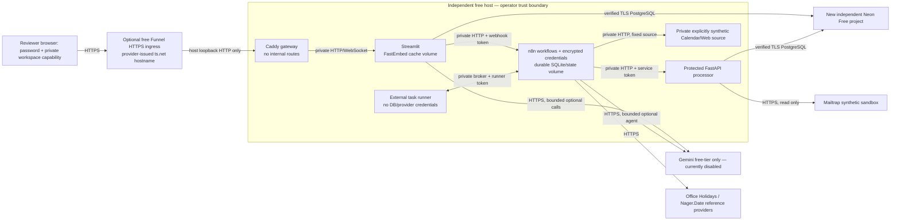

# Deployment architecture and trust boundaries

Primary preparation: Oracle Always Free ARM host + separate Neon Free project + optional Tailscale Personal Funnel provider hostname. Eligibility/capacity/TLS remain unprovisioned. The six-service Compose definition is provider-independent; the local rehearsal adds two isolated PostgreSQL containers only.

`compose.hosted.yaml` is a standalone deployment definition, not an override of the development database. `compose.funnel.yaml` replaces direct public gateway ports with **127.0.0.1:8505**; it does not start Funnel or change any account. The future owner-approved Funnel command publishes only that guarded app listener. Direct Caddy HTTPS on 80/443 is available after domain/DNS approval. n8n has no public webhook/editor port because Streamlit calls it privately.

| Origin → destination | Protocol/auth | Exposure / required permission | Data / failure behavior |
| --- | --- | --- | --- |
| Reviewer → Funnel or direct gateway | HTTPS; app password gate | Public 443; direct mode additionally needs 80 for ACME/redirect. Funnel mode needs no public app-port firewall rule. | Synthetic interface data; deny protected routes, size bound and security headers. |
| Host Funnel → gateway | HTTP loopback; trusted local daemon | Host 127.0.0.1:8505 only | Forwarded HTTPS scheme; local machine is trusted. Funnel setup is pending. |
| Gateway → app | HTTP/WebSocket, frontend bridge | Private service DNS; no host app port in production | Password/capability forms and UI; gateway cannot reach backend bridge directly. |
| App → n8n | HTTP, exact configured private origin + header credential | Backend bridge only; app never sends tokens to browser | Owner/run/intent, bounded trigger; uncertain delivery requires reconciliation. |
| n8n → processor | HTTP + independent service header | Backend bridge only; no public processor routes | Bounded source/stage data and authoritative checks; 401/429/503 handled explicitly. |
| n8n → fixture | HTTP, fixed named service | Internal source bridge; fixture has no Internet network or public port | Labelled synthetic calendar/registration data; failure becomes source outcome. |
| Runner ↔ n8n broker | Authenticated broker HTTP/WebSocket | Separate internal runner bridge, broker 5679; runner has no other bridge or state volume | Code tasks; broker/runner failures fail bounded workflow. |
| App/processor → Neon | PostgreSQL TLS `verify-full`, system CA, dedicated role | Outbound 5432 to approved new endpoint; no original DB dependency | Private histories/audit records; sanitized 503, no automatic request replay. |
| App/n8n → Gemini | HTTPS provider credentials, global daily bounds | Outbound 443; disabled until free-tier project confirmed | Retrieved synthetic evidence and model responses; quota/refusal/unavailable is explicit. |
| Processor → Mailtrap | HTTPS token, read-only code path | Outbound 443 | Labelled example.com sandbox messages; no sends, auth/timeout failures isolated. |
| n8n → Calendar/Web providers | HTTPS, fixed approved backend configuration | Outbound 443 | External public reference observations; unrelated data stays incomplete. |
| Operator → host/Neon/n8n | SSH and private CLI / owner console | Restricted SSH source/VPN; no public editor | Secrets, migration and backup privileges; deliberate release operations only. |

Private bridges are segmentation, not a complete egress firewall. App has Internet access for Gemini/model download/Neon; processor and n8n need provider egress. Enforce approved destinations at the host/provider firewall if stronger egress control is required. No Docker socket, host namespace or original application network is mounted.

n8n default external runner has been exercised, with read-only filesystem/non-root user and no credential/state mounts. Some specialized AI tools are n8n integrations rather than ordinary Code-node runner tasks: external runner configuration is not a proof that every integration runs outside the main n8n process. Only the owner may edit/publish workflows. The agent still has exactly three validated read-only tools and cannot change deterministic decisions.
